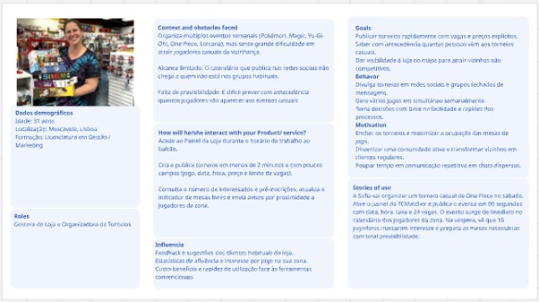
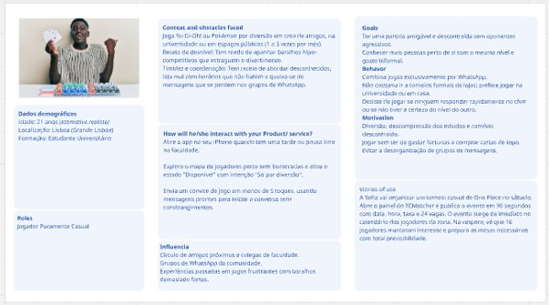
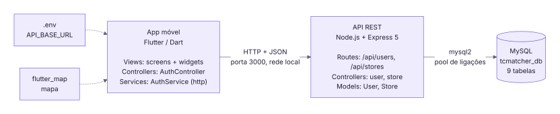
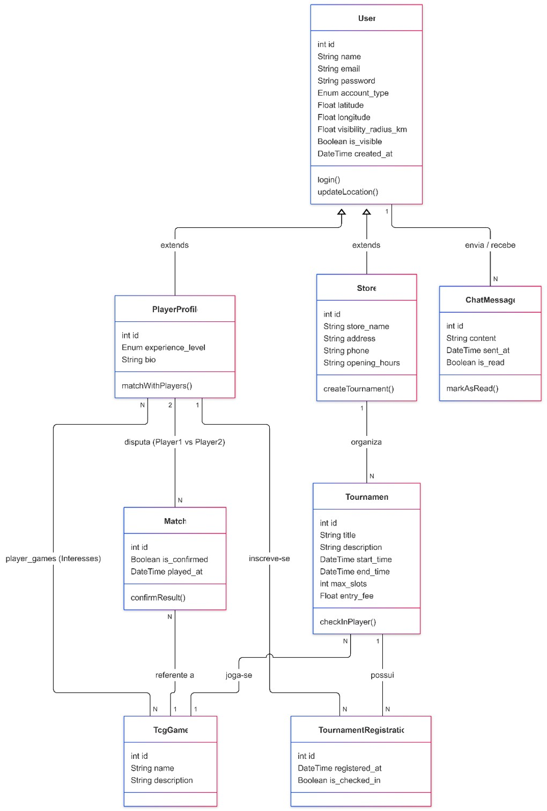
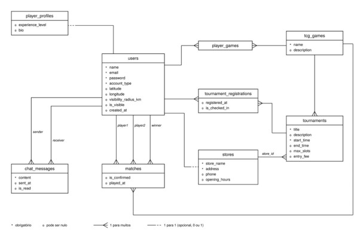
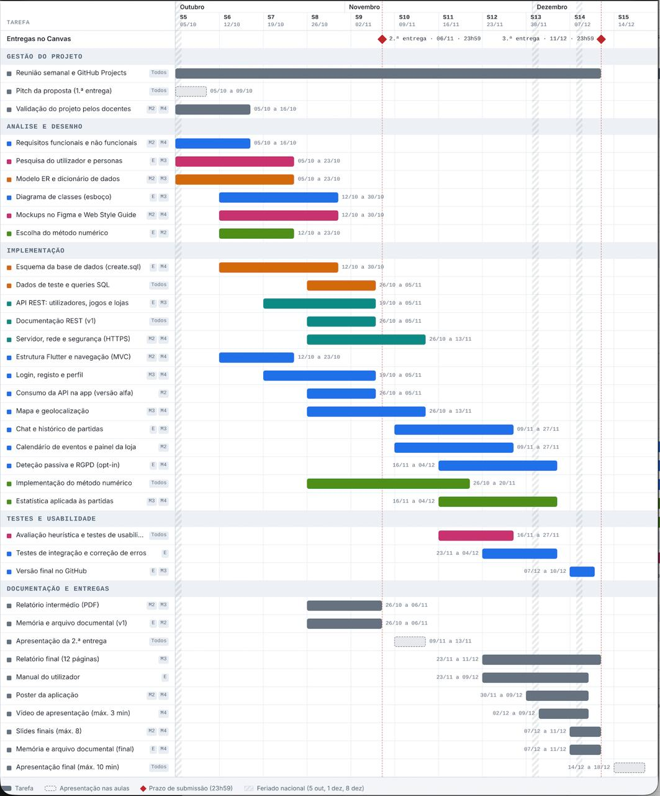
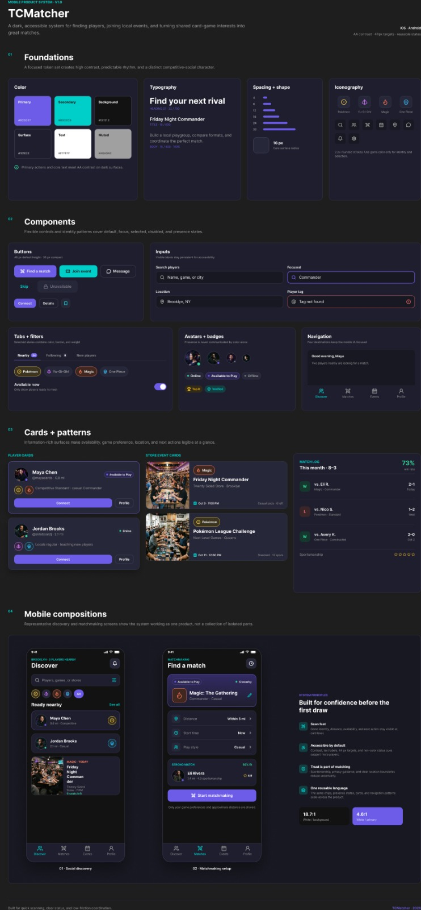
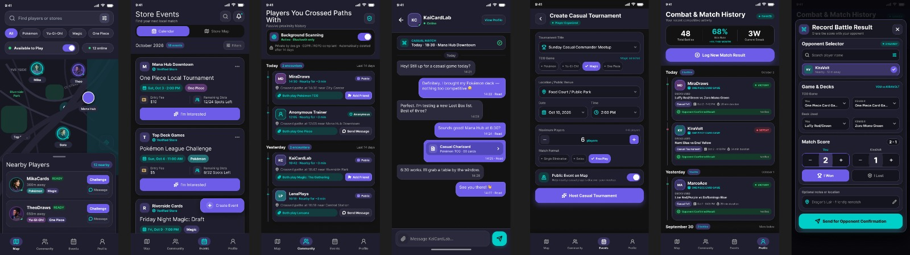
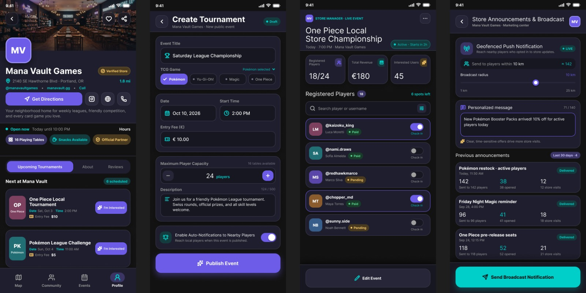

# UNIVERSIDADE EUROPEIA / IADE 
## Faculdade de Design, Tecnologia e Comunicação
### Licenciatura em Engenharia Informática
**Projeto Multidisciplinar – Projeto Mobile (3.º Semestre / 2026-2027)**

---

# TCMatcher 
### Plataforma de Geolocalização e Gestão de Comunidades para Trading Card Games
*Relatório Intermédio (Entrega 2)*

---

## Identificação dos Estudantes

* **Estudante 1:**
  * **Nome Completo:** Samuel Livramento Alves Longo
  * **Número de Estudante:** 20251469
  * **Curso:** Licenciatura em Engenharia Informática
  * **Ano Curricular:** 2.º Ano / 3.º Semestre
  * **Email Institucional:** 20251469@iade.pt

* **Estudante 2:**
  * **Nome Completo:** Matheus Reis Correia Borges
  * **Número de Estudante:** 20250417
  * **Curso:** Licenciatura em Engenharia Informática
  * **Ano Curricular:** 2.º Ano / 3.º Semestre
  * **Email Institucional:** 20250417@iade.pt

* **Estudante 3:**
  * **Nome Completo:** Elmer Otchali Safeca Moreso
  * **Número de Estudante:** 20250922
  * **Curso:** Licenciatura em Engenharia Informática
  * **Ano Curricular:** 2.º Ano / 3.º Semestre
  * **Email Institucional:** 20250922@iade.pt

* **Estudante 4:**
  * **Nome Completo:** Henrique Alexandre Corrêa Carvalho
  * **Número de Estudante:** 20250852
  * **Curso:** Licenciatura em Engenharia Informática
  * **Ano Curricular:** 2.º Ano / 3.º Semestre
  * **Email Institucional:** 20250852@iade.pt

---

## Corpo Docente e Unidades Curriculares Envolvidas

* **Projeto de Desenvolvimento Móvel:** Prof. Fábio Guilherme
* **Programação de Dispositivos Móveis:** Prof. João Pedro Monge
* **Bases de Dados:** Prof. Miguel Boavida
* **Redes e Comunicações de Dados:** Prof. Nathan Campos & Prof. Pedro Rosa
* **Interfaces e Usabilidade:** Prof.ª Paula Neves
* **Matemática Discreta:** Prof. André Torcato & Prof. Ricardo de Sousa

---

## Acesso ao Repositório do Projeto

* **GitHub Repository:** [https://github.com/Bodinthekid/TCMatcher](https://github.com/Bodinthekid/TCMatcher)

**Palavras-Chave:**  
`Trading Card Games (TCG)` · `Geolocalização` · `Flutter & Dart` · `Node.js REST API` · `MySQL` · `Mobile Matching` · `Comunidades Locais`

---

## Índice

1. [Introdução e Enquadramento](#introdução-e-enquadramento)
2. [Objetivos e Motivação](#objetivos-e-motivação)
3. [Público-alvo, Personas e Análise de Mercado](#público-alvo-personas-e-análise-de-mercado)
4. [Casos de Utilização](#casos-de-utilização)
5. [Arquitetura do Sistema e Enquadramento Técnico](#arquitetura-do-sistema-e-enquadramento-técnico)
6. [Diagrama de Classes](#diagrama-de-classes)
7. [Base de Dados](#base-de-dados)
   * [Modelo Entidade-Relação](#modelo-entidade-relação)
   * [Arquitetura e Modelação](#arquitetura-e-modelação)
   * [Herança e Especialização de Entidades](#herança-e-especialização-de-entidades)
   * [Normalização e Relações de Muitos-para-Muitos](#normalização-e-relações-de-muitos-para-muitos)
   * [Auto-Relacionamentos](#auto-relacionamentos)
   * [Dicionário de Dados](#dicionário-de-dados)
   * [Guia de Dados](#guia-de-dados)
8. [Documentação REST](#documentação-rest)
9. [Privacidade e Conformidade com RGPD](#privacidade-e-conformidade-com-rgpd)
10. [Planeamento e Calendarização](#planeamento-e-calendarização)
11. [Conclusão](#conclusão)
12. [Anexos](#anexos)
13. [Bibliografia](#bibliografia)

---

## Introdução e Enquadramento

O universo dos Trading Card Games (TCG), que engloba títulos mundialmente reconhecidos como Pokémon TCG, Yu-Gi-Oh!, Magic: The Gathering e o recente e popular One Piece Card Game, tem registado um grande crescimento nos últimos anos. Estes jogos destacam-se não apenas pela sua componente estratégica e colecionável, mas fundamentalmente pela sua forte vertente social. No entanto, a comunidade enfrenta um obstáculo significativo: a dificuldade em encontrar adversários fora do contexto de torneios oficiais.

Nos dias de hoje, a prática presencial destes jogos está altamente centralizada nas lojas físicas especializadas (*Game Stores*). Embora estas lojas sejam o centro do mundo competitivo, a dependência exclusiva destes espaços cria vários problemas. Os jogadores são obrigados a pagar taxas de inscrição em torneios apenas para poder jogar, e os encontros casuais ficam restritos ao horário de funcionamento destas lojas. Tirando estes espaços, o encontro casual entre jogadores é feito de maneira fragmentada através das redes sociais.

É neste contexto que surge o presente projeto: a aplicação móvel **TCMatcher**. Esta plataforma propõe-se a atuar como uma ponte entre o digital e o físico, permitindo que jogadores encontrem adversários nas suas proximidades geográficas para partidas casuais e gratuitas em espaços públicos. Em simultâneo, a aplicação não exclui as lojas; pelo contrário, integra-as no ecossistema através de perfis dedicados onde podem gerir e promover os seus torneios, criando uma simbiose entre o jogo casual e competitivo.

### Estado Atual do Projeto (Entrega 2)

Este relatório atualiza a primeira proposta do TCMatcher e mostra o estado atual do projeto. A ideia mantém-se: uma aplicação que ajuda os jogadores de Trading Card Games (Pokémon TCG, Yu-Gi-Oh!, Magic: The Gathering e One Piece Card Game) a encontrar adversários perto de si e que dá às lojas uma forma de chegar a esses jogadores.

Desde a primeira entrega fizemos pesquisa com utilizadores em Interfaces e Usabilidade: um questionário a seis jogadores e a uma loja e uma avaliação heurística da app *Magic: The Gathering Companion*. Todos os jogadores combinam os jogos em grupos de WhatsApp, Telegram ou Discord e cinco em seis queixam-se de horários e desmarcações. Por isso, indicar o nível e a intenção de jogo (casual ou competitivo) e responder a um pedido de jogo com outra hora passaram a ser requisitos essenciais. A deteção passiva de jogadores passou para segundo plano, porque ninguém a referiu, e o terceiro caso de utilização da proposta foi substituído.

No lado técnico, já temos uma primeira versão a funcionar: a API em Node.js, a base de dados MySQL e a app em Flutter, que já permite criar contas e efetuar login através da API. O repositório foi também reorganizado segundo a estrutura do briefing.

---

## Objetivos e Motivação

A principal motivação para o desenvolvimento desta aplicação nasce da necessidade de modernizar e descentralizar a forma como as comunidades de TCG se reúnem. O projeto planeia disseminar o acesso ao jogo presencial, removendo as dificuldades financeiras e logísticas das partidas casuais.

Os objetivos principais do projeto dividem-se em duas vertentes: o utilizador (jogador e loja) e a vertente técnica e académica.

### Objetivos Funcionais
* Desenvolver um sistema de geolocalização num mapa interativo que exiba jogadores disponíveis e lojas num determinado raio de alcance.
* Implementar um sistema de gestão de histórico de partidas, permitindo aos jogadores registarem as suas vitórias, derrotas e analisarem o seu desempenho.
* Fornecer um sistema de deteção passiva que registe em segundo plano o cruzamento físico entre utilizadores com interesses em comum.
* Criar ferramentas de publicação de calendários de eventos exclusivos para contas de Lojas/Organizadores.

### Objetivos Técnicos e Académicos
* Desenvolver uma interface móvel multiplataforma em **Flutter**.
* Estruturar uma API RESTful utilizando **Node.js**.
* Modelar e implementar uma base de dados relacional robusta em **MySQL**.
* Garantir uma experiência de utilização fluida e intuitiva através do **Figma**.

---

## Público-alvo, Personas e Análise de Mercado

O público-alvo desta aplicação é dividido, atendendo a dois segmentos que dependem intrinsecamente um do outro:

* **Jogadores de TCG (Casuais e Competitivos):** Indivíduos que procuram testar os seus baralhos (*decks*), treinar para torneios ou simplesmente socializar através do jogo, sem restrições de espaço ou custos associados.
* **Lojas Físicas e Organizadores Locais:** Pequenos e médios negócios que necessitam de uma plataforma direcionada para anunciar os seus eventos, vender os seus produtos e atrair a comunidade local para o seu espaço físico.

### Personas


#### Persona 1: Sofia – Gestora de Loja e Organizadora de Torneios



#### Persona 2: Jogador Puramente Casual


### Análise de Mercado

Na fase de **Pesquisa de Mercado**, foram analisadas plataformas atualmente utilizadas pelos jogadores. Em relação ao mercado, a *Magic: The Gathering Companion* (4,7 em 5 na App Store) e a *BANDAI TCG+* (2,0 em 5) servem para torneios oficiais de um só fabricante e não mostram jogadores próximos. Estas apps focam-se quase em exclusivo na componente burocrática da organização de torneios oficiais, são exclusivas dos seus respetivos jogos e ignoram a componente social de descoberta de jogadores casuais no dia a dia. Por outro lado, o *SpellTable* é para jogar Magic através de webcam. O **TCMatcher** junta vários jogos numa única plataforma e mostra quem está disponível perto e com que nível, promovendo o encontro presencial e integrando um sistema de chat e comunidades.

---

## Casos de Utilização

Para ilustrar a funcionalidade e o percurso do utilizador dentro da aplicação, detalham-se de seguida os três guiões de teste principais, que descrevem passo a passo as interações com o sistema:

### Guião de Teste 1: Encontrar e Desafiar um Jogador Casual
* **Ator:** Jogador de TCG
* **Objetivo:** Encontrar um adversário próximo, combinar uma partida e registar o resultado.
* **Cenário:** O utilizador encontra-se numa praça de alimentação de um centro comercial com o seu deck de One Piece e tem uma hora livre.
* **Passos:**
  1. O utilizador abre a aplicação TCMatcher e efetua o login (autenticação) no seu telemóvel.
  2. No ecrã principal (Mapa/Descobrir), seleciona o jogo "One Piece TCG" nos filtros de pesquisa.
  3. O utilizador clica no *toggle* (botão) para alterar o seu estado para "Disponível para jogar".
  4. O sistema atualiza o mapa interativo e exibe um pin de outro jogador com preferências compatíveis nas proximidades (ex: a 200 metros).
  5. O utilizador clica no pin do adversário para consultar o seu perfil público e visualiza a sua taxa de vitórias (*win rate*).
  6. O utilizador clica no botão de "Mensagem" e envia uma mensagem direta através do chat integrado (ex: *"Olá, queres fazer um jogo rápido?"*).
  7. Após realizarem a partida presencialmente, o utilizador acede à secção de Histórico de Partidas e submete o resultado do jogo (Vitória/Derrota).
  8. O sistema processa o resultado e atualiza automaticamente o histórico e as estatísticas de batalha no perfil de ambos os jogadores.

### Guião de Teste 2: Gestão de Calendário por uma Loja Local
* **Ator:** Gestor da Loja
* **Objetivo:** Criar e promover um evento competitivo oficial na aplicação.
* **Cenário:** Uma loja pretende organizar um torneio local de Pokémon TCG para o próximo sábado.
* **Passos:**
  1. O gestor da loja abre a aplicação e efetua o login (autenticação) com as credenciais da sua conta Store.
  2. O sistema reencaminha o utilizador para o *Dashboard* (Painel de Controlo) específico para lojas.
  3. O gestor navega até à aba "Eventos" e clica no botão "Criar Evento/Torneio".
  4. O gestor preenche o formulário de criação de evento com os seguintes dados: Jogo (ex: Pokémon TCG), Data, Hora, Taxa de Inscrição e Limite de Vagas.
  5. O gestor clica no botão "Publicar Evento".
  6. O sistema guarda o torneio na base de dados, adiciona um pin de destaque da loja no mapa geral e emite uma notificação para os jogadores num raio predefinido.
  7. Jogadores na área visualizam o evento na aba "Calendário" e clicam em "Marcar Interesse", o que atualiza automaticamente a previsão de afluência no ecrã do gestor da loja.

### Guião de Teste 3: Deteção Passiva por Proximidade e Conexão
* **Ator:** Jogador (com permissões de localização ativas)
* **Objetivo:** Descobrir jogadores com interesses comuns com os quais o utilizador se cruzou fisicamente ao longo do dia.
* **Cenário:** Dois utilizadores desconhecidos, mas ambos jogadores de Yu-Gi-Oh!, caminham pela mesma rua ou frequentam a mesma universidade.
* **Passos:**
  1. O utilizador (Jogador A) caminha na rua ou universidade com a aplicação a correr em segundo plano (*background*).
  2. O sistema (servidor) utiliza os serviços de localização para detetar a interseção das áreas entre o Jogador A e um Jogador B (ambos com interesse partilhado em, por exemplo, Yu-Gi-Oh!).
  3. O servidor regista o cruzamento de forma anónima, sem revelar coordenadas exatas.
  4. Mais tarde, o Jogador A abre ativamente a aplicação TCMatcher.
  5. O utilizador navega até à aba de notificações ou secção "Pessoas com quem te cruzaste".
  6. O sistema exibe uma lista de perfis compatíveis detetados nas últimas horas.
  7. O utilizador clica no perfil do Jogador B e seleciona a opção "Enviar pedido de mensagem" para agendar futuros encontros casuais.


---

## Arquitetura do Sistema e Enquadramento Técnico

Para tornar esta solução viável, o projeto foi arquitetado tendo em conta as melhores práticas da engenharia de software e os requisitos curriculares estabelecidos para o semestre em curso. A arquitetura continua a ser **Cliente-Servidor** em três camadas principais (Frontend, Backend e Base de Dados).

1. **Frontend:** A aplicação móvel é desenvolvida em **Flutter** com a linguagem **Dart**, permitindo compilar código nativo para Android e iOS a partir de uma única base de código. A interface de utilizador (UI) foi prototipada no **Figma**, prevendo uma distinção clara entre os menus dos Jogadores e o Dashboard das Lojas.
2. **Backend:** A app Flutter comunica por **HTTP e JSON** com a API REST em **Node.js** com **Express**, que guarda os dados em **MySQL**.
3. **Padrão MVC:** Na app e na API seguimos o padrão MVC:
   * **Na App:** `screens` e `widgets` são as *views*, `controllers` gere o estado (`AuthController`) e `services` faz os pedidos HTTP (`AuthService`).
   * **Na API:** as `routes` definem os endpoints (`/api/users`, `/api/stores`), os `controllers` tratam os pedidos (`user`, `store`) e os `models` têm o SQL (`User`, `Store`).

  
* **Figura 1:** Arquitetura da versão alfa

### Enquadramento nas Unidades Curriculares e Tecnologias

Em termos de unidades curriculares:
* **Programação de Dispositivos Móveis:** A app, a API e a integração com a base de dados.
* **Bases de Dados:** O modelo e os scripts SQL.
* **Interfaces e Usabilidade:** A pesquisa com utilizadores, as personas e os requisitos.
* **Redes e Comunicações de Dados:** A comunicação cliente-servidor na rede local (porta 3000, com passagem prevista para HTTPS).
* **Matemática Discreta:** Propomos, ainda a validar com os professores, usar o método de Monte Carlo para sugerir um raio de procura por defeito.

**Tecnologias e pacotes utilizados:**
* **Flutter:** `http`, `flutter_dotenv` e `flutter_map`.
* **Node.js:** `express`, `mysql2`, `cors` e `dotenv`.
* **MySQL:** versão 8.0.16 ou superior (a tabela `matches` usa uma restrição `CHECK`).

**Estado da versão alfa:** O servidor tem as rotas `/api/users` e `/api/stores`, a app cria contas e faz login através da API e a base de dados tem nove tabelas. Ao rever o código encontrámos pontos a corrigir:
* As palavras-passe estão em texto simples (vamos usar `bcrypt`);
* O `GET /api/users` mostra os emails de todos sem login;
* O registo de uma loja pode deixar uma conta sem loja;
* Faltam tabelas para a disponibilidade e os pedidos de jogo;
* O ficheiro `queries.sql` ainda está vazio.

---

## Diagrama de Classes

  
* **Figura 2:** Esboço do diagrama de classes.

O diagrama de classes abstrato ilustra a estrutura de objetos da nossa plataforma. O modelo utiliza o princípio da herança, onde uma superclasse genérica `User` (que concentra dados de login e geolocalização: `id`, `name`, `email`, `password`, `account_type`, `latitude`, `longitude`, `visibility_radius_km`, `is_visible`, `created_at`, com métodos `login()` e `updateLocation()`) desdobra-se nas subclasses `PlayerProfile` (`id`, `experience_level`, `bio`, `matchWithPlayers()`) e `Store` (`id`, `store_name`, `address`, `phone`, `opening_hours`, `createTournament()`), permitindo separar lógica de jogo casual e organização comercial. Adicionalmente, destacam-se as relações entre os utilizadores e as entidades principais, como `Tournament` (`checkInPlayer()`), `Match` (auto-relacionamento de confrontos com `confirmResult()`), `ChatMessage` (`markAsRead()`), `TcgGame` e `TournamentRegistration`.

---

## Base de Dados

### Modelo Entidade-Relação

A base de dados `tcmatcher_db` usa `InnoDB` e `utf8mb4`. O diagrama segue a notação das aulas de Bases de Dados: `*` para atributos obrigatórios, `o` para os que podem ser nulos, pé de galinha no lado "muitos" e linha tracejada para as relações 1 para 1 opcionais. A tabela `users` guarda todas as contas, e `player_profiles` e `stores` são extensões opcionais (0 ou 1) para jogadores e lojas. As relações muitos-para-muitos estão decompostas nas entidades `player_games` e `tournament_registrations`.

  
* **Figura 3:** Modelo Entidade-Relação (a partir do `create.sql`).

### Arquitetura e Modelação

O desenvolvimento da base de dados relacional para a plataforma TCMatcher teve como foco central a integridade dos dados, a normalização estrutural e a flexibilidade necessária para suportar um ecossistema misto de utilizadores. A infraestrutura foi implementada em MySQL. Esta escolha técnica garante a conformidade com a aplicação rigorosa de chaves estrangeiras para manter a integridade do sistema.

### Herança e Especialização de Entidades

A principal decisão arquitetural na modelação foi a adoção do padrão de herança (Superclasse/Subclasse). A tabela `users` atua como a entidade genérica do sistema, armazenando exclusivamente os dados partilhados por todos os atores da plataforma: credenciais de autenticação, geolocalização e configurações de privacidade. Dependendo do tipo de conta (definido pelo discriminador `account_type`), esta entidade desdobra-se numa relação de 1 para opcional para as tabelas `player_profiles` (com atributos como nível de experiência e biografia) ou `stores` (com morada física e horários). Esta estratégia elimina a profusão de valores nulos (`NULL`) que ocorreria caso atributos de jogadores e lojas coexistissem numa única tabela monolítica.

### Normalização e Relações de Muitos-para-Muitos

A base de dados foi desenhada respeitando as regras de normalização, garantindo que não existem dependências transitivas e minimizando a redundância. Todas as relações complexas de muitos-para-muitos (N:M) foram decompostas através de tabelas associativas de ligação. Por exemplo, a tabela `player_games` liga os jogadores aos seus jogos favoritos sem duplicar a informação da lista contida em `tcg_games`. De igual modo, a tabela `tournament_registrations` faz a ponte entre os eventos criados e os inscritos, agregando atributos próprios da interação, como a data de registo e a validação do check-in presencial na loja.

### Auto-Relacionamentos

Para suportar o núcleo de interatividade da aplicação, o modelo tira partido de auto-relacionamentos (*self-relationships*) sobre a entidade `users`. A tabela `matches` regista os confrontos presenciais, ao conectar dois utilizadores (jogador 1 e jogador 2) e garantindo a coerência dos dados através da restrição `CHECK (player1_id <> player2_id)`, que impede que um utilizador registe uma partida contra si mesmo. O mesmo princípio estrutural é aplicado à tabela `chat_messages`, que cruza emissores e recetores para possibilitar as mensagens diretas.

### Dicionário de Dados

#### Entidades Principais e Herança

**Tabela `users`**  
Entidade genérica que centraliza a autenticação e geolocalização de todos os utilizadores da plataforma.

| Campo | Tipo de Dados | Descrição |
| :--- | :--- | :--- |
| `id` | `INT` | Identificador único do utilizador. |
| `name` | `VARCHAR` | Nome do jogador ou responsável pela loja. |
| `email` | `VARCHAR` | E-mail para login e contacto. |
| `password` | `VARCHAR` | Hash criptográfico da palavra-passe. |
| `account_type` | `ENUM` | Discriminador de subtipo (`'PLAYER'`, `'STORE'`, `'ADMIN'`). |
| `latitude` | `DECIMAL` | Coordenada geográfica de latitude. |
| `longitude` | `DECIMAL` | Coordenada geográfica de longitude. |
| `visibility_radius_km` | `DECIMAL` | Raio de alcance (em km) para matching local. |
| `is_visible` | `INT` | Indicador de estado online/visível no mapa. |
| `created_at` | `DATETIME` | Data e hora de registo da conta. |

**Tabela `player_profiles`**  
Extensão 1 para opcional da tabela `users` contendo os dados específicos de perfis de jogadores.

| Campo | Tipo de Dados | Descrição |
| :--- | :--- | :--- |
| `id` | `INT` | Identificador único do perfil. |
| `user_id` | `INT` | Referência à conta-mãe (`users.id`). |
| `experience_level` | `ENUM` | Nível de habilidade (`'BEGINNER'`, `'CASUAL'`, `'COMPETITIVE'`). |
| `bio` | `TEXT` | Apresentação curta do jogador. |

**Tabela `stores`**  
Extensão 1 para opcional da tabela `users` para contas do tipo loja física.

| Campo | Tipo de Dados | Descrição |
| :--- | :--- | :--- |
| `id` | `INT` | Identificador único da loja. |
| `user_id` | `INT` | Referência à conta-mãe (`users.id`). |
| `store_name` | `VARCHAR` | Nome comercial ou público do estabelecimento. |
| `address` | `VARCHAR` | Morada física completa para localização no mapa. |
| `phone` | `VARCHAR` | Número de contacto telefónico da loja. |
| `opening_hours` | `VARCHAR` | Descrição dos horários e dias de abertura. |

#### Lista de Jogos e Eventos

**Tabela `tcg_games`**  
Lista central dos jogos de cartas (TCGs) suportados pela aplicação.

| Campo | Tipo de Dados | Descrição |
| :--- | :--- | :--- |
| `id` | `INT` | Identificador único do jogo. |
| `name` | `VARCHAR` | Nome comercial do TCG (ex: Pokémon TCG, Magic). |
| `description` | `TEXT` | Resumo descritivo ou regras gerais do jogo. |

**Tabela `tournaments`**  
Registo dos torneios e eventos organizados pelas lojas.

| Campo | Tipo de Dados | Descrição |
| :--- | :--- | :--- |
| `id` | `INT` | Identificador único do torneio. |
| `store_id` | `INT` | Referência à loja organizadora (`stores.id`). |
| `game_id` | `INT` | Referência ao TCG específico do evento (`tcg_games.id`). |
| `title` | `VARCHAR` | Título público do evento. |
| `description` | `TEXT` | Detalhes sobre o evento, prémios ou formato. |
| `start_time` | `DATETIME` | Data e hora de início marcadas. |
| `end_time` | `DATETIME` | Data e hora previstas para o encerramento. |
| `max_slots` | `INT` | Capacidade máxima de participantes. |
| `entry_fee` | `DECIMAL` | Taxa de inscrição. |

#### Entidades de Ligação e Interação Social

**Tabela `player_games`**  
Associa quais os TCGs que cada jogador pratica.

| Campo | Tipo de Dados | Descrição |
| :--- | :--- | :--- |
| `user_id` | `INT` | Referência ao jogador (`users.id`). |
| `game_id` | `INT` | Referência ao jogo TCG (`tcg_games.id`). |

**Tabela `tournament_registrations`**  
Controla os inscritos e a validação de presença (check-in) nos eventos.

| Campo | Tipo de Dados | Descrição |
| :--- | :--- | :--- |
| `id` | `INT` | Identificador único da inscrição. |
| `tournament_id` | `INT` | Referência ao evento/torneio. |
| `user_id` | `INT` | Referência ao jogador inscrito. |
| `registered_at` | `DATETIME` | Data e hora de submissão da inscrição. |
| `is_checked_in` | `INT` | Indicador de presença física no local (Check-in). |

**Tabela `matches`**  
Guarda o registo das partidas disputadas entre dois jogadores.

| Campo | Tipo de Dados | Descrição |
| :--- | :--- | :--- |
| `id` | `INT` | Identificador único da partida. |
| `player1_id` | `INT` | Referência ao jogador 1 (`users.id`). |
| `player2_id` | `INT` | Referência ao jogador 2 (`users.id`). |
| `game_id` | `INT` | Jogo TCG disputado na partida. |
| `winner_id` | `INT` | Vencedor da partida. |
| `is_confirmed` | `INT` | Confirmação do resultado pelo adversário. |
| `played_at` | `DATETIME` | Data e hora do encontro. |

**Tabela `chat_messages`**  
Regista as mensagens trocadas no chat direto entre utilizadores.

| Campo | Tipo de Dados | Descrição |
| :--- | :--- | :--- |
| `id` | `INT` | Identificador único da mensagem. |
| `sender_id` | `INT` | Utilizador que enviou a mensagem (`users.id`). |
| `receiver_id` | `INT` | Utilizador que recebe a mensagem (`users.id`). |
| `content` | `TEXT` | Conteúdo textual da mensagem. |
| `sent_at` | `DATETIME` | Data e hora de envio. |
| `is_read` | `INT` | Estado de leitura (`0` = Não Lida, `1` = Lida). |

### Guia de Dados

O `populate.sql` tem, por agora, 9 utilizadores (6 jogadores no Porto, em Lisboa e em Coimbra e 3 lojas) e os dados das 3 lojas. Todos os dados são inventados. Para simular o uso real vamos acrescentar os 4 jogos, um perfil por jogador, cerca de 6 torneios (passados, futuros e um lotado), 15 inscrições, 10 partidas (incluindo um empate) e duas conversas de chat. Com isto o `queries.sql` vai poder mostrar, por exemplo, os jogadores a menos de 5 km, os torneios com vagas e a taxa de vitórias de cada jogador.

---

## Documentação REST

Primeira versão, no formato indicado no briefing. URL base `http://<IP do servidor>:3000`, pedidos e respostas em JSON e ainda sem autenticação por token.

### Registar utilizador
* **URL / Method:** `/api/users/register` · `POST`
* **Data Params:** `name`, `email`, `password` (obrigatórios); `account_type`, `latitude`, `longitude` (opcionais); `store_name` e `address` obrigatórios para contas `STORE`
* **Success Response:** `201` `{ "message": "Conta de PLAYER registada com sucesso!", "userId": 10 }`
* **Error Response:** `400` campos em falta · `409` email já registado · `500` erro interno
* **Sample Call:**
  ```bash
  curl -X POST [http://192.168.1.10:3000/api/users/register](http://192.168.1.10:3000/api/users/register) \
    -H "Content-Type: application/json" \
    -d '{"name":"Tiago","email":"tiago@example.com","password":"Teste123!"}'
  ```

### Iniciar sessão
* **URL / Method:** `/api/users/login` · `POST`
* **Data Params:** `email`, `password` (obrigatórios)
* **Success Response:** `200` `{ "message": "Login efetuado com sucesso!", "user": { "id": 1, "name": "João Silva", "email": "joao.silva@email.com", "account_type": "PLAYER" } }`
* **Error Response:** `400` campos em falta · `401` email ou palavra-passe incorretos · `500` erro interno

### Listar lojas
* **URL / Method:** `/api/stores` · `GET`
* **Success Response:** `200` lista de lojas com `store_name`, `address`, `phone`, `opening_hours`, `latitude` e `longitude`
* **Error Response:** `500` erro interno
* **Notes:** O `mysql2` devolve as coordenadas como texto.

### Obter a loja de um utilizador
* **URL / Method:** `/api/stores/user/:userId` · `GET`
* **URL Params:** `userId` (obrigatório)
* **Success Response:** `200` dados da loja
* **Error Response:** `404` loja não encontrada · `500` erro interno

 Existem ainda `GET /` (verifica se a API está ligada) e `GET /api/users` (lista utilizadores, só para testes). Os próximos endpoints serão os jogos, o perfil, a localização, a disponibilidade, os jogadores próximos, os pedidos de jogo, as mensagens e os torneios.

---

## Privacidade e Conformidade com RGPD

Um dos maiores desafios tecnológicos e éticos deste projeto encontra-se na gestão de dados de geolocalização. Sendo o tratamento de dados sensíveis regulamentado pelo **Regulamento Geral sobre a Proteção de Dados (RGPD)**, a aplicação adotará medidas estritas de segurança.

A localização exata dos utilizadores **nunca será publicamente exibida**. Em vez de apresentar coordenadas geográficas precisas no mapa de outros jogadores, o sistema utilizará raios de aproximação e arredondamentos matemáticos. Adicionalmente, funcionalidades como a deteção passiva atuarão estritamente em regime de *opt-in* e poderão ser desativadas a qualquer instante.

---

## Planeamento e Calendarização

O trabalho que falta foi dividido em duas sprints. As tarefas a verde já estão feitas (datas do histórico do GitHub) e o resto será acompanhado no GitHub Projects:

* **Entrega 2 (feito):**
  * API de autenticação e ecrãs de login e registo
  * Mapa na app
  * Reorganização do repositório (briefing)
  * Relatório intermédio
* **Sprint 3 (9 a 22/11):**
  * Semana da apresentação da 2.ª entrega
  * Disponibilidade e pedidos de jogo (BD, API, app)
  * Segurança, hash de passwords e validações
  * `populate.sql` completo e `queries.sql`
  * Integrar ecrãs de loja (PR 28)
* **Sprint 4 (23/11 a 6/12) e Entrega 3:**
  * Torneios e inscrições de ponta a ponta
  * Chat entre jogadores
  * Testes de usabilidade com 3 participantes
  * Manual do utilizador, poster e vídeo
  * Relatório final e auto-avaliação
  * Entrega final (11 de dezembro de 2026)

  
* **Figura 4:** Planeamento até à 3.ª entrega (11 de dezembro de 2026).

---

## Conclusão

A plataforma **TCMatcher** representa uma solução tecnológica completa para um problema altamente específico, mas de elevada relevância para uma comunidade em forte expansão. Juntar a geolocalização dos jogadores com os calendários das lojas torna esta aplicação numa ferramenta muito útil e essencial para toda a comunidade de TCG.

Neste momento, o TCMatcher já tem uma base funcional: a API está a correr, a base de dados tem o modelo do domínio e a app cria contas e faz login. A pesquisa com utilizadores mostrou-nos o que é mais urgente: ficar disponível, ver o nível dos outros e marcar um jogo sem desmarcações.

Até à entrega final queremos pôr o caso de utilização principal a funcionar do princípio ao fim, ligar os torneios das lojas à API, corrigir os problemas de segurança, completar os scripts SQL e fazer testes de usabilidade com pelo menos três pessoas.

---

## Anexos

 <br>
* **Figura A.1** – Design System e Guia de Estilos da Aplicação TCMatcher (Figma)

 <br>
* **Figura A.2** – Ecrãs de Interação do Jogador, Deteção e Histórico de Partidas

 <br>
* **Figura A.3** – Interfaces de Gestão de Eventos e Lojas Parceiras

---

## Bibliografia

* BANDAI. (s.d.). *BANDAI TCG+* [App]. App Store. [https://apps.apple.com/app/id1599299476](https://apps.apple.com/app/id1599299476)
* Bocoup. (s.d.). *Documenting your API*. [https://bocoup.com/blog/documenting-your-api](https://bocoup.com/blog/documenting-your-api)
* Grupo 02. (2026). *TCMatcher: Estratégia UX, investigação, avaliação heurística e requisitos* (Interfaces e Usabilidade, Fase 1). Universidade Europeia / IADE.
* Oracle. (s.d.). *MySQL 8.0 Reference Manual: CHECK constraints*. [https://dev.mysql.com/doc/refman/8.0/en/create-table-check-constraints.html](https://dev.mysql.com/doc/refman/8.0/en/create-table-check-constraints.html)
* Wizards of the Coast. (s.d.). *Magic: The Gathering Companion* [App]. App Store. [https://apps.apple.com/us/app/magic-the-gathering-companion/id1455161962](https://apps.apple.com/us/app/magic-the-gathering-companion/id1455161962)